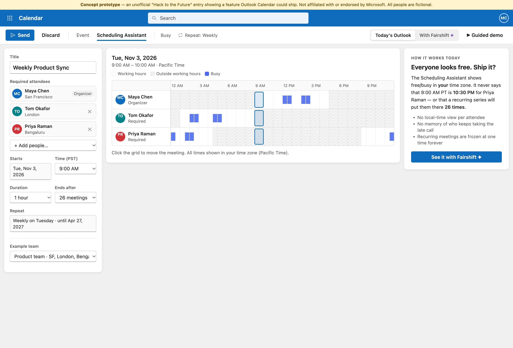
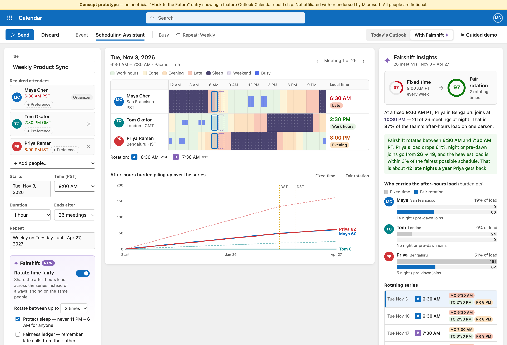
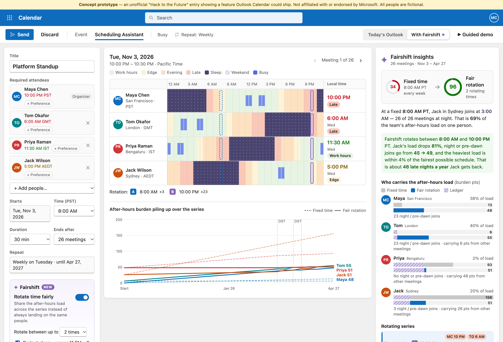

# Fairshift for Outlook Calendar ✦

**Who's always taking the 10:30 PM call?** Fairshift is a feature concept for **Outlook Calendar**. It shows what a meeting time costs each attendee *in their own local time*, and it gives recurring meetings a **Rotate time fairly** switch. The after-hours load then gets shared across the team instead of always falling on the same people.

> Built for **Hack to the Future: Build the feature your favorite app is missing**.
> This is an unofficial concept prototype. It is not affiliated with or endorsed by Microsoft, and all people in it are fictional.

**Live demo:** https://ashank-crazy.github.io/outlook-fairshift/. Click **▶ Guided demo** for a 9-step walkthrough.
**Demo video (2:30):** *(YouTube link)*

| Before: Outlook today | After: with Fairshift |
|---|---|
|  |  |

---

## The problem

Global teams book recurring meetings at a time that works for headquarters. The same people then join at 10 PM or 6 AM every week, for months. Outlook's Scheduling Assistant shows free/busy in **the organizer's** time zone. For a recurring series, nothing tracks who keeps absorbing the inconvenience, and nothing can share it.

Example: Maya in San Francisco books a weekly sync at 9:00 AM PT. Everyone shows as free. For Priya in Bengaluru, that is **10:30 PM, 26 weeks in a row**, and she ends up carrying **87%** of the team's after-hours load.

## What Fairshift adds to the Scheduling Assistant

| | |
|---|---|
| **Local-time lens** | Each attendee's row is coloured by *their* local time: work hours, edge, evening, late, sleep, and weekend (the date line turns Friday afternoon in the US into Saturday in Sydney). A *Local time* column shows "10:30 PM · Sleep" next to every name. |
| **Burden score** | Every minute of every occurrence is scored in the attendee's own time zone with real DST rules. 1 pt = 1 hour just outside your day. Late-night hours count ×4 and sleep hours ×10. |
| **Fairness score** | 0–100. **100 means the most-burdened person carries no more than the fairest schedule these time zones allow.** Some burden can't be avoided because of where people live; the score measures only the avoidable part. |
| **Rotate time fairly** | One switch. Fairshift searches every half-hour of the day and every rotation of up to 3 times, then plans the series. Fixed 9:00 AM scores **37**; the fair rotation scores **97**. |
| **Protect sleep** | No occurrence ever lands between 11 PM and 6 AM for anyone. |
| **Fairness ledger** | Optionally counts late calls people already take in *other* meetings, so the rotation spares them. |
| **Early bird / night owl** | Each attendee can say whether a 7 AM or a 9 PM call costs them less. The planner discounts the side they prefer (never sleep hours). |
| **Best single time** | Organizers who don't want a rotating series still get the fairest fixed time, with a one-click "Use it". |
| **DST-aware series** | The US, UK and India change clocks on different dates. Fairshift re-scores each occurrence and marks the weeks where times shift. |
| **Invite that explains itself** | The invitation says the series rotates and lists each attendee's local time for the next meetings. |
| **Before/after toggle** | Switch between *Today's Outlook* and *With Fairshift* in the top-right corner. |



## How the planner works

1. **Score**: for each candidate start time (every 30 min, organizer's time) and each occurrence date, compute every attendee's burden in 15-minute slices using `Intl` time-zone data, so DST, half-hour offsets (India) and date-line weekends are all handled. Double-booking against someone's busy blocks adds a planner-only penalty.
2. **Prune**: drop times that would wake anyone up (if *Protect sleep* is on), then keep the Pareto front: times where no other option is at least as good for everyone.
3. **Rotate**: for every combination of 1–3 front times, greedily assign each occurrence to whichever time keeps the **most-burdened person's running total lowest** (minimax), plus a smaller weight on total burden so nobody is inconvenienced for nothing. Ties go to the least-recently used time. A small penalty per extra time keeps the series simple.
4. **Explain**: report fixed vs. rotated burden per person, share of load, night/pre-dawn joins, and fairness against the best achievable schedule.

The search covers 48 candidate times × 26 occurrences × all subsets in about 10 ms in the browser. The engine is a single dependency-free file: [`js/fairshift.js`](js/fairshift.js).

## How Microsoft could ship it

Everything Fairshift needs is already in Exchange/Microsoft Graph:

- Each attendee's time zone and working hours come from `mailboxSettings.workingHours` (`daysOfWeek`, `startTime`, `endTime`, `timeZone`).
- Free/busy comes from `getSchedule` / `findMeetingTimes`.
- A rotating series is a normal recurring event with **modified occurrences** (exceptions), which Outlook supports today, so no new calendar primitive is needed.

**Rollout path:**
1. Ship the local-time lens as a read-only overlay in the Scheduling Assistant.
2. Add *Rotate time fairly* as an opt-in toggle for recurring meetings in Insider/Targeted Release.
3. Connect the fairness ledger to Viva Insights, which already measures after-hours collaboration, with burden visible only to the organizer and the attendee themselves.

## Run it

No build step and no dependencies:

```bash
open index.html            # or: python3 -m http.server 8080
npm test                   # node --test: DST, date line, scoring, rotation, ledger, preferences
```

Handy deep links: `?mode=classic`, `?rotate=1`, `?team=follow-sun&rotate=1&ledger=1`, `?tour=1`, `?invite=1&rotate=1`, `?still=1` (no animations).

## How the demo video was made

The video is generated by a script, not screen-captured by hand. [`video/record.js`](video/record.js) drives the real app in headless Chrome over the DevTools protocol: a visible cursor clicks through the feature, each scene is timed to its narration line, and the page is captured as a screencast. [`video/tts.py`](video/tts.py) voices [`video/narration.json`](video/narration.json) with the open-source **Kokoro-82M** neural TTS model, offline. ffmpeg then mixes the two into a 1080p MP4.

## Built with

- HTML, CSS, vanilla JavaScript (no frameworks), using the `Intl.DateTimeFormat` time-zone database for DST-correct local times
- Node.js built-in test runner
- GitHub Pages for hosting
- AI tools: built with **Claude Code (Claude Opus 5.5)** as the AI pair-programmer; demo voiceover by **Kokoro-82M** (open-source TTS)
- Chrome DevTools Protocol + ffmpeg for the scripted demo recording

## Project structure

```
index.html          Outlook-style event composer + Scheduling Assistant shell
styles.css          Fluent-inspired styling
js/fairshift.js     Engine: time-zone math, burden model, fairness score, rotation planner
js/people.js        Fictional directory and example teams
js/app.js           UI rendering, before/after toggle, guided demo, invite preview
tests/              Engine tests (node --test)
video/              Scripted demo recording: narration, Kokoro TTS, Chrome DevTools recorder
docs/               Screenshots
```

MIT licensed.
